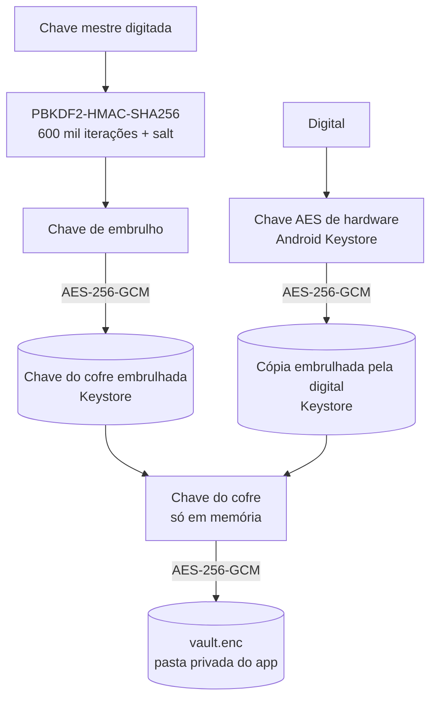
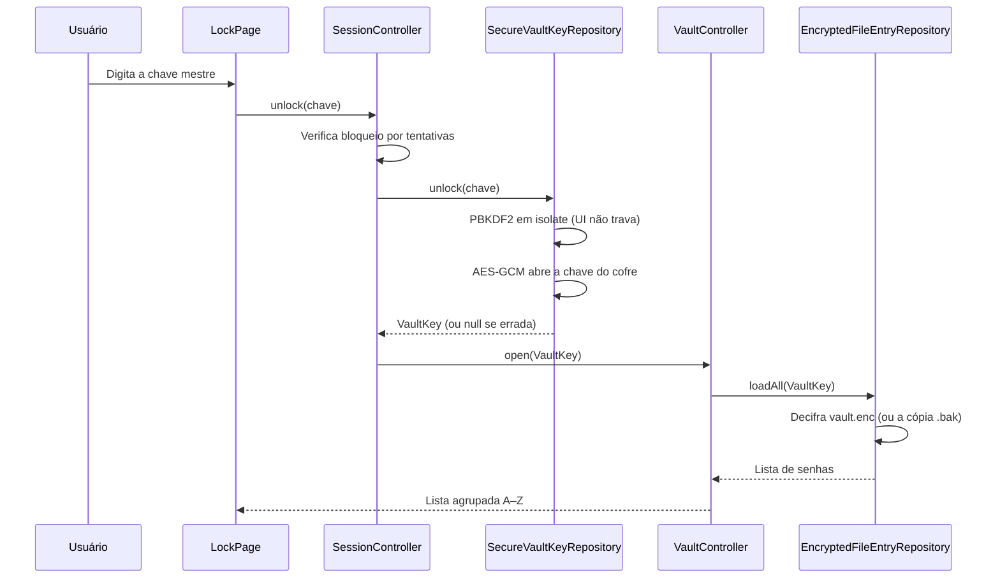
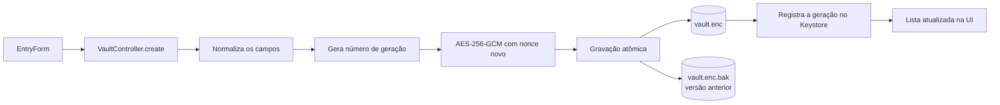
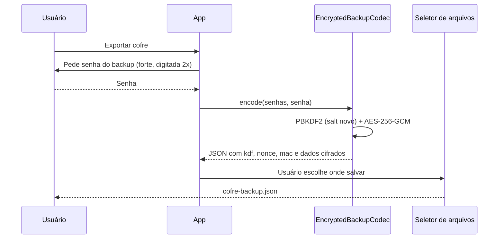
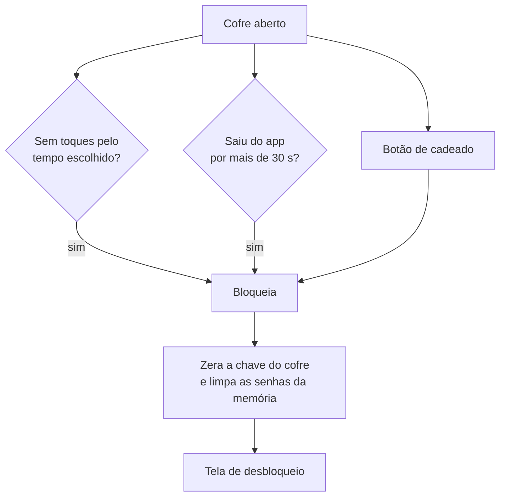

## Cofre — Gerenciador de Senhas Offline

### O que o app faz

- **Guardar senhas** com título, usuário, senha, URL, notas e cor do monograma
- **Listar senhas** agrupadas de A a Z, com busca e indicador de força de cada senha
- **Gerar senhas fortes** de 20 caracteres com gerador criptograficamente seguro
- **Copiar com segurança** — a senha copiada é marcada como sensível e some da área de transferência em 30 s
- **Desbloquear com chave mestre ou digital** — a digital usa uma chave de hardware do Android Keystore
- **Bloqueio automático** por inatividade (1, 2, 5, 15, 30 min ou nunca) e 30 s depois de sair do app
- **Backup criptografado** — exporta e importa um arquivo `.json` cifrado com uma senha escolhida na hora
- **Tema claro, escuro ou do sistema**

Tudo fica **só no aparelho**: não há servidor, conta nem sincronização. As senhas só saem do celular pela exportação manual.

---

## Estrutura do projeto

O código segue uma arquitetura **Feature-First**: cada funcionalidade tem suas camadas `domain`, `data` e `presentation`, e o que é compartilhado fica em `core`.

```
cofre/
├── lib/
│   ├── app/                 # Montagem das dependências, shell e navegação
│   ├── core/
│   │   ├── security/        # PBKDF2, AES-256-GCM, chave do cofre, política de senhas
│   │   ├── services/        # Área de transferência, bloqueio do aparelho, arquivos, links
│   │   ├── storage/         # Gravação atômica de arquivos
│   │   ├── theme/           # Cores (OKLCH), tipografia, espaçamentos, animações
│   │   └── widgets/         # Componentes reutilizáveis
│   └── features/
│       ├── lock/            # Chave mestre, digital, tentativas e sessão
│       ├── vault/           # Senhas, formulário, busca, backup
│       └── settings/        # Tema, bloqueio automático, digital
├── android/app/src/main/kotlin/   # Canais nativos (digital, área de transferência, bloqueio de tela)
└── test/                    # Testes de unidade, widget e fluxo completo
```

| Camada | Tecnologias principais |
|--------|------------------------|
| **App** | Flutter 3.47, Dart 3.13, Material 3, `ChangeNotifier` + `ListenableBuilder` |
| **Criptografia** | `cryptography` — PBKDF2-HMAC-SHA256 (600 mil iterações) e AES-256-GCM |
| **Armazenamento** | `flutter_secure_storage` (Keystore) e arquivo cifrado na pasta privada (`path_provider`) |
| **Nativo (Android)** | Kotlin, `androidx.biometric`, Android Keystore, `FLAG_SECURE` |
| **Arquivos** | `file_picker` para escolher onde salvar e abrir o backup |
| **Interface** | `google_fonts` (Manrope e JetBrains Mono), `material_symbols_icons` |

---

## Arquitetura geral

O app **não tem backend**. Toda a lógica roda no aparelho, e as senhas nunca ficam em texto puro no disco.

```
┌─────────────────────────────────────────────────────────────────┐
│                     APP (Flutter)                               │
│  Pages → Widgets → Controllers (ChangeNotifier)                 │
│  SessionController · VaultController · SettingsController       │
└───────────────────────────────┬─────────────────────────────────┘
                                │
                                ▼
┌─────────────────────────────────────────────────────────────────┐
│                 DOMÍNIO E SEGURANÇA (Dart)                      │
│  Repositories → KeyDerivation (PBKDF2) → SymmetricCipher (AES)  │
│  VaultKey só em memória enquanto o cofre está aberto            │
└───────────────┬─────────────────────────────┬───────────────────┘
                │                             │ MethodChannel
                ▼                             ▼
    ┌──────────────────────┐       ┌──────────────────────────┐
    │  Pasta privada       │       │  Android (Kotlin)        │
    │  vault.enc           │       │  BiometricKeyChannel     │
    │  vault.enc.bak       │       │  SensitiveClipboard      │
    │  (AES-256-GCM)       │       │  DeviceAuthChannel       │
    └──────────────────────┘       └────────────┬─────────────┘
                                                │
              ┌─────────────────────────────────┘
              ▼
    ┌─────────────────────────────┐
    │      ANDROID KEYSTORE       │
    │  Chave do cofre embrulhada  │
    │  Chave de hardware da       │
    │  digital · preferências     │
    └─────────────────────────────┘
```

---

## Fluxos principais

### 1. Criptografia em camadas

Uma **chave do cofre** aleatória (256 bits) cifra as senhas. Ela nunca é salva aberta: fica guardada "embrulhada" pela chave mestre e, se a digital estiver ligada, por uma chave de hardware.



- Trocar ou cadastrar uma digital nova no aparelho **invalida** a chave de hardware, e o app pede a chave mestre de novo
- Ao bloquear, os bytes da chave do cofre são **zerados** na memória

---

### 2. Desbloqueio com chave mestre



Depois de **5 erros**, cada novo erro bloqueia novas tentativas por 30 s, 1 min, 2 min… até **1 hora**. O tempo é contado pelo relógio monotônico do aparelho, então adiantar a data do sistema não encurta a espera.

---

### 3. Salvar uma senha



- O mesmo formulário serve para **criar e editar**
- A gravação é **atômica**: se o app fechar no meio, a versão anterior continua intacta
- O **número de geração** permite perceber se o arquivo voltou para uma versão antiga, e o app avisa o usuário

---

### 4. Backup criptografado



- A importação só aceita o formato **cifrado**: um arquivo em texto puro poderia ter sido montado por qualquer um
- As senhas importadas **somam** às que já estão no cofre
- Limites contra arquivos maliciosos: até **10 MB** e **5.000** senhas
- Com 5 senhas ou mais e nenhum backup nos últimos 30 dias, aparece um **lembrete** na lista

---

### 5. Bloqueio da sessão



| Proteção | Comportamento |
|------|---------------|
| **Inatividade** | Bloqueia depois de 1, 2, 5, 15 ou 30 min sem toques (padrão: 5 min) |
| **Segundo plano** | Bloqueia 30 s depois de sair do app; escolher o arquivo de backup não conta |
| **Prints e multitarefa** | `FLAG_SECURE` impede capturas de tela e esconde o conteúdo na lista de apps recentes |
| **Backup do Android** | Desligado (`allowBackup="false"`): os dados não vão para a nuvem automaticamente |
| **Esqueci a chave mestre** | Apaga o cofre depois de uma palavra de confirmação e do bloqueio de tela do aparelho |

---

## Plataformas

- **Android**

Versão atual do app: **1.0.0**
